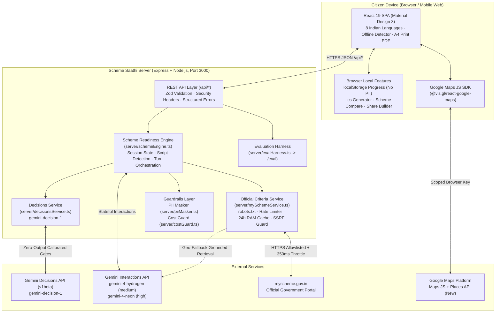

# High-Level Design (HLD) — Scheme Saathi

**Document Version:** 1.0  
**Application:** Scheme Saathi — Indian Citizen Government Scheme Readiness Companion  
**Architecture Style:** Full-Stack TypeScript SPA + Express BFF (Backend-for-Frontend) with Tiered Gemini AI Orchestration

---

## 1. Executive Summary & Problem Statement

Indian citizens searching for central and state welfare schemes (farming, scholarships, family healthcare, and artisan/small-business livelihoods) face three persistent barriers:
1. **Fragmented eligibility criteria** across portals, often leading to rejected applications due to hidden exclusions or missing documents.
2. **Language and digital literacy friction**, where official portals are dense and predominantly in English.
3. **Privacy and trust risks**, especially when citizens share sensitive documents such as Aadhaar cards, land records, or bank passbooks.

**Scheme Saathi** solves this as an **application-readiness companion**—not a form-submission bot. In under 3 minutes, across **8 Indian languages**, it converts a citizen's natural-language description into:
- Calibrated potential scheme matches grounded strictly in live official [`myscheme.gov.in`](https://www.myscheme.gov.in) criteria.
- An interactive **Ready / Missing** document checklist with state-aware *"How to get this"* guidance and optional consent-first photo verification.
- Side-by-side **Scheme Comparison & Stacking Checks**, **Shareable Summaries**, **Print-Optimized A4 PDF Dossiers**, **`.ics` Calendar Reminders**, and an interactive **Google Maps Nearby CSC / Help Centre Locator**.

### Core Product Invariants
- **Never silently submits** any application to any government portal or third party.
- **Never fabricates** eligibility criteria, benefits, or URLs; all links are strictly validated `https:` official domains.
- **Zero persistent PII storage**: Uploaded document photos and raw identifiers are processed strictly in server RAM and never written to disk, database, or logs.

---

## 2. System Context & Architecture Diagram

---

## 3. Architectural Components

### 3.1 Presentation Layer (`src/`)
- **Framework:** React 19 + TypeScript + Tailwind CSS v4, built with Vite 8.
- **Design System:** Google Material Design 3 (Material You) cool neutral tonal architecture (`#F8FAFD` surface, `#F0F4F9` tonal containers, `#0B57D0` primary blue, `#D3E3FD` primary container, `#146C2E` tertiary green, 28dp dialogs, stadium actions, M3 primary bottom-indicator tabs).
- **Split-Pane Workspace:**
  - **Left Pane (`App.tsx`)**: State/UT & District auto-filter (36 Indian States/UTs), multilingual quick-start cards, conversational timeline with follow-up suggestion chips, network connectivity detector, and save/resume progress banner.
  - **Right Pane (`PlanPanel.tsx`)**: Sticky action plan with 3 M3 primary tabs (**Matches**, **Documents**, **Next step**), compact scheme status badges (**Eligible**, **Potentially Eligible**, **Missing Docs**), Share drawer, Print-Optimized A4 PDF export, Side-by-Side Scheme Comparison modal, Calendar Reminder (`.ics`) modal, What-If Fact Editor, and Google Maps Help Centre Locator modal.
- **8 Indian Regional Languages:** Full UI localization, Google Noto Sans script fonts, locale-aware date/time formatting, and regional map labels for English (`en`), Hindi (`hi`), Marathi (`mr`), Tamil (`ta`), Telugu (`te`), Bengali (`bn`), Kannada (`kn`), and Gujarati (`gu`).

### 3.2 Backend-for-Frontend (`server.ts`)
- Single Express server serving both `/api/*` endpoints and the frontend (Vite middleware in development; static `dist/` bundle in production).
- Enforces strict Zod input validation on every route, payload caps (10 MB JSON body / 6 MB decoded document image), and security headers (`X-Content-Type-Options: nosniff`, `Referrer-Policy: strict-origin-when-cross-origin`, disabled `x-powered-by`).

### 3.3 Tiered AI Orchestration Layer (`server/decisionsService.ts`, `server/schemeEngine.ts`)
Scheme Saathi separates **calibrated decisioning** from **conversational generation** to minimize latency, cost, and hallucination:

| Tier | Model ID (`shared/models.ts`) | API | Purpose | Thinking / Config |
| --- | --- | --- | --- | --- |
| **Gate & Calibration** | `gemini-decision-1` | `ai.decisions.create` (`v1beta`) | 4-question batched turn gate (on-topic, journey, completeness 0–3, conflict detection), multimodal document type/legibility check, calibrated per-scheme eligibility scoring. | Zero output tokens; confidence `< 0.75` triggers clarification or escalation. |
| **Routine Synthesis** | `gemini-4-hydrogen` | `ai.interactions.create` | Conversational replies in 8 languages, concise follow-up questions (max 5/session), document field extraction, structured plan assembly. | `thinking_level: "medium"`, stateful `previous_interaction_id`. |
| **Complex Escalation** | `gemini-4-neon` | `ai.interactions.create` | Triggered **only** when `gemini-decision-1` detects conflicting eligibility criteria, exclusion edge cases (e.g., taxpayer/pensioner/joint land), or routing confidence `< 0.75`. | `thinking_level: "high"`, triggers mandatory human handoff banner. |

### 3.4 Official Scheme Retrieval Layer (`server/mySchemeService.ts`)
- Fetches live criteria from `myscheme.gov.in` / `api.myscheme.gov.in`.
- Honors `robots.txt` (cached), enforces a 350ms outbound throttle queue, sends an honest `User-Agent`, validates all URLs via strict SSRF allowlists (`https:` only, `.gov.in` / `.nic.in` / `.org.in`, private/metadata IPs blocked), deduplicates concurrent journey requests, and caches bundles in memory for 24 hours (`MYSCHEME_CACHE_TTL_HOURS`).
- When direct API access is geo-blocked outside India, uses live grounded search against `myscheme.gov.in` with live HTTPS URL verification—never falling back to hardcoded/mocked rules.

### 3.5 Privacy, Consent & Budget Guardrails (`server/piiMasker.ts`, `server/costGuard.ts`)
- **Explicit Consent Gate:** Document photo endpoints return `403 CONSENT_REQUIRED` until the citizen grants per-session consent; revoking consent immediately clears extracted document records from session memory.
- **Defense-in-Depth PII Masking:** Regex masking on both server and client export pipelines ensures 12-digit Aadhaar numbers render as `XXXX-XXXX-1234` and 9–18 digit bank account numbers render as `XXXX1234`.
- **Cost Guardrails:** In-memory per-session token cap (`DEFAULT_SESSION_TOKEN_CAP = 45,000`) and UTC daily spend ceiling (`DEFAULT_DAILY_SPEND_CAP_USD = $5.00`), targeting `<= $0.05` per citizen session.

### 3.6 Location & Field Help Layer (`HelpCentreLocatorModal.tsx`)
- Uses Google Maps Platform (`@vis.gl/react-google-maps`) with **Places API (New)** (`Place.searchByText`), `AdvancedMarker` + `Pin`, and `InfoWindow` to locate nearby **CSC Kiosks**, **Tehsil/Block Offices**, and **Bank Branches** across India (`region="IN"`), localized to the citizen's active language.

### 3.7 Evaluation Harness (`server/evalHarness.ts`, `src/components/EvalPage.tsx`)
- Accessible at `/eval`. Runs synthetic citizen profiles (`complete`, `incomplete`, `ambiguous`) across languages to measure explanation accuracy, checklist completeness, source URL traceability, latency, model routing, and estimated cost.

---

## 4. High-Level Data Flows

### 4.1 Citizen Eligibility Discovery Flow
1. Citizen optionally picks a **State/UT** and **District** and sends a message (or taps a quick-start card) in any of the 8 supported languages.
2. Backend detects script/language and runs a single batched `gemini-decision-1` call to check query relevance, classify journey (`farmer | student | health | livelihood | other`), score completeness (`0–3`), and detect conflicts.
3. For classified journeys, `mySchemeService` returns live official scheme records (from 24h RAM cache or live fetch).
4. `gemini-decision-1` scores each fetched scheme against known citizen facts to produce calibrated `High / Medium / Low` confidence labels.
5. `gemini-4-hydrogen` (or `gemini-4-neon` on ambiguity/conflict) generates the citizen-language response, follow-up choices, and structured plan updates.
6. PII masker sanitizes all output fields before returning `{ session, assistantMessage, routingMeta }` to the UI.

### 4.2 Client-Side Citizen Utility Flows (Zero Server Round-Trip)
- **Scheme Comparison & Stacking Check:** Deterministic comparison of 2–3 matched schemes on document readiness, shared documents, same-category/exclusion stacking flags, and recommended first scheme.
- **Share Summary:** Builds a privacy-scrubbed plain-text summary for selected schemes with one-tap Copy (iframe-safe fallback), WhatsApp, and SMS links.
- **A4 PDF Export:** Triggers browser print-to-PDF using dedicated `@media print` A4 rules that render all sections (Eligibility Profile, Scheme Matches with printed URLs, Document Checklist with steps, Next Official Action & Helplines).
- **Calendar Reminders (`.ics`):** Generates standards-compliant RFC 5545 `.ics` files with smart presets and a 1-day advance `VALARM`.

---

## 5. Non-Functional Requirements

| Dimension | Target / Implementation |
| --- | --- |
| **Performance & Cost** | Batched zero-output-token Decisions API gates + 24h scheme cache + Hydrogen default tier keep target session cost around `$0.05`. |
| **Offline Resilience** | `useNetworkStatus` detects offline state, pauses network-only actions gracefully, and allows reading/saving/exporting the active plan locally. |
| **Privacy** | Zero database persistence for citizen chat or document photos; session state lives solely in server RAM and optional sanitized browser `localStorage` (no photos, no masked IDs). |
| **Security** | Server-side `GEMINI_API_KEY` isolation, Zod schema enforcement, SSRF host allowlisting, HTTPS-only link rendering, zero `dangerouslySetInnerHTML`. |
| **Accessibility** | Material 3 WCAG AA contrast tokens, `>= 44px` interactive touch targets, ARIA roles (`tablist`, `dialog`, `menu`, `alert`, `status`), keyboard Escape dismissal, icon+text status indicators (never hue-only). |

---

## 6. Deployment Topology

- **Development (`npm run dev`):** `tsx server.ts` mounts Vite middleware on port `3000`.
- **Production (`npm run build && npm start`):** Vite compiles the SPA into `dist/`; `node server.ts` serves `/api/*` and static `dist/` assets on `0.0.0.0:${PORT:-3000}`.
- **Recommended Cloud Run Region:** `asia-south1` (Mumbai) for lowest latency to Indian citizens and direct access to `myscheme.gov.in`.
