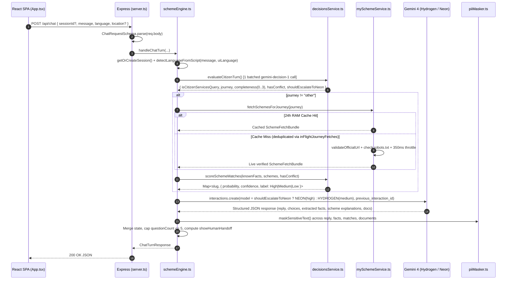
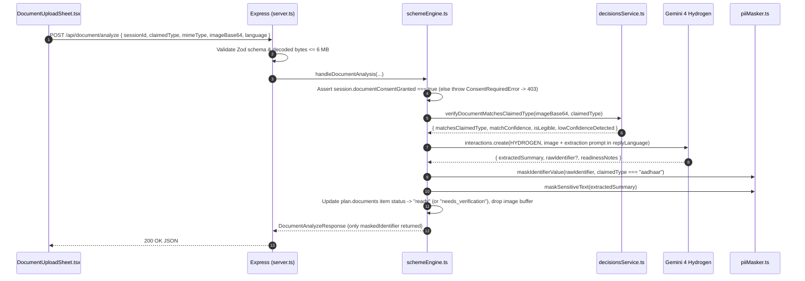

# Low-Level Design (LLD) — Scheme Saathi

**Document Version:** 1.0  
**Scope:** Module responsibilities, sequence diagrams, data structures, deterministic client algorithms, caching, i18n, and error taxonomy.

---

## 1. Repository Module Map

```text
/
├── server.ts                          # Express entry point, Zod request validation, security headers, static/Vite mount
├── shared/
│   ├── models.ts                      # Single source of truth for MODELS, thresholds, SUPPORTED_LANGUAGES, domain types
│   └── indiaStates.ts                 # 36 Indian States & UTs: Hindi/English names, land-record terms, portals, map centers
├── server/
│   ├── geminiClient.ts                # @google/genai client singletons (Interactions + v1beta Decisions) & transient retry
│   ├── decisionsService.ts            # gemini-decision-1 gates (turn routing, multimodal doc check, scheme calibration)
│   ├── schemeEngine.ts                # In-memory session store, script detector, chat/recheck/document turn orchestration
│   ├── mySchemeService.ts             # Live myScheme fetcher, robots.txt cache, 350ms rate limiter, SSRF guard, 24h cache
│   ├── piiMasker.ts                   # Regex PII masking for Aadhaar (XXXX-XXXX-1234) and bank accounts (XXXX1234)
│   ├── costGuard.ts                   # Per-session token & daily UTC USD spend ledger + DemoBudgetExceededError
│   └── evalHarness.ts                 # Synthetic 3-profile bilingual evaluation suite (/eval)
├── src/
│   ├── main.tsx                       # React 19 root mount
│   ├── index.css                      # Tailwind v4, Material Design 3 tokens, Noto Sans regional fonts, @media print A4 CSS
│   ├── App.tsx                        # Main citizen workspace, M3 8-language menu, state/district filter, chat timeline
│   ├── api.ts                         # Typed fetch wrapper for all /api/* routes + ApiClientError
│   ├── i18n.ts                        # UiCopy interface, English & Hindi copy, exports UI_COPY: Record<Language, UiCopy>
│   ├── i18nRegional.ts                # Native translations for mr, ta, te, bn, kn, gu deep-merged onto EN_COPY
│   ├── hooks/
│   │   └── useNetworkStatus.ts        # Online/offline & reconnection state hook
│   ├── lib/
│   │   ├── schemeCompare.ts           # Deterministic scheme comparison, stacking check, & 3-state card status badge logic
│   │   ├── calendarReminder.ts        # RFC 5545 .ics builder, line folder, PII scrubber, smart presets, Blob downloader
│   │   ├── shareChecklist.ts          # Privacy-safe shareable text formatter, WhatsApp/SMS URLs, iframe-safe clipboard copy
│   │   ├── documentGuides.ts          # State-aware "How to get this" issuance steps & official portal links per doc type
│   │   └── sessionStorage.ts          # Browser localStorage save/resume serializer (explicitly strips photos & masked IDs)
│   └── components/
│       ├── PlanPanel.tsx              # Sticky M3 plan surface (Matches + status badges, Documents, Next Step, Share, Print)
│       ├── SchemeCompareModal.tsx     # Side-by-side 2–3 scheme comparison & stacking check dialog
│       ├── CalendarReminderModal.tsx  # Smart preset + custom .ics reminder dialog
│       ├── HelpCentreLocatorModal.tsx # Google Maps Platform (@vis.gl/react-google-maps) Places API (New) CSC/Bank locator
│       ├── ConsentModal.tsx           # Explicit per-session photo consent dialog
│       ├── DocumentUploadSheet.tsx    # Document type picker + 6 MB client-side image reader
│       └── EvalPage.tsx               # /eval dashboard UI
└── docs/
    ├── HLD.md                         # High-Level Design
    ├── LLD.md                         # Low-Level Design (this document)
    ├── API_SPEC.md                    # REST API schemas & status codes
    └── SECURITY_AND_PRIVACY.md        # Consent, PII, SSRF, and AI grounding controls
```

---

## 2. Detailed Request Sequence Diagrams

### 2.1 Chat Turn Orchestration (`POST /api/chat`)



### 2.2 Consent-First Document Analysis (`POST /api/document/analyze`)



---

## 3. Core Data Structures (`/shared/models.ts`)

### 3.1 Model & Threshold Constants
- `MODELS.DECISION = "gemini-decision-1"`
- `MODELS.HYDROGEN = "gemini-4-hydrogen"` (`THINKING_LEVELS.HYDROGEN_DEFAULT = "medium"`)
- `MODELS.NEON = "gemini-4-neon"` (`THINKING_LEVELS.NEON_ESCALATION = "high"`)
- `CONFIDENCE_THRESHOLDS`:
  - `DECISION_ESCALATION = 0.75`
  - `HIGH_MATCH_PROB = 0.74`, `HIGH_CONFIDENCE = 0.78`
  - `MEDIUM_MATCH_PROB = 0.48`, `MEDIUM_CONFIDENCE = 0.65`
- `SESSION_LIMITS`:
  - `MAX_FOLLOW_UP_QUESTIONS = 5`
  - `MAX_DOCUMENT_BYTES = 6 * 1024 * 1024` (6 MB)
  - `DEFAULT_SESSION_TOKEN_CAP = 45_000`
  - `DEFAULT_DAILY_SPEND_CAP_USD = 5.0`

### 3.2 Domain Contracts
- **`SessionSnapshot`**: `{ sessionId, language, questionCount, maxQuestions, documentConsentGranted, plan: PlanState, budget }`
- **`PlanState`**: `{ journey, location?, profileCompletenessScore(0..3), profileCompletenessPercent(0..100), knownFacts[], unknownFacts[], matches: SchemeMatch[], documents: DocumentChecklistItem[], nextStepSummary, showHumanHandoff, humanHandoffReason?, handoffChannels[], sourceFetchStatus, sourceFetchNotice?, lastFetchedAt? }`
- **`SchemeMatch`**: `{ slug, schemeName, category, whyItMayFit, whatToVerify[], whatIsMissing[], nextOfficialAction, officialChannelUrl, sourceUrl, fetchedAt, confidence: "High"|"Medium"|"Low", confidenceSource: "decision-1"|"decision-1+neon", decisionProbability, decisionConfidence }`
- **`DocumentChecklistItem`**: `{ id, documentType, label, status: "ready"|"missing"|"needs_verification", detail, maskedIdentifier?, requiredForSchemes[] }`

---

## 4. Deterministic Client-Side Algorithms

### 4.1 Scheme Status Badges (`src/lib/schemeCompare.ts` → `getSchemeCardStatus`)
Computes one of three visual badges for each card in `PlanPanel`'s **Matches** tab, updating reactively when citizens check off documents or verify photos:
1. Link checklist items to the scheme by normalized `schemeName` / `slug` match.
2. Mark a document ready if `doc.status === "ready"` (photo-verified) **or** `manualReadyDocIds.includes(doc.id)`.
3. State transition rules:
   - **`missing_docs`** (*"Missing Docs"*): Any linked doc is not ready and has `status === "missing"`, OR zero linked checklist docs exist and `match.whatIsMissing.length > 0`.
   - **`eligible`** (*"Eligible"*): `match.confidence === "High"` AND no linked docs remain in `needs_verification` or `missing`.
   - **`potentially_eligible`** (*"Potentially Eligible"*): Default for `Medium`/`Low` confidence or when linked documents still need verification.

### 4.2 Side-by-Side Comparison & Stacking Check (`src/lib/schemeCompare.ts` → `compareSelectedSchemes`)
- **Per-scheme readiness:** Computes `readyDocCount`, `totalDocCount`, deduplicated `missingDocs`, and `readinessPercent`.
- **Shared documents:** Aggregates checklist items referenced by `>= 2` compared schemes, sorted by coverage count.
- **Recommended first scheme:** Deterministic sort by `CONFIDENCE_RANK` (`High=3, Medium=2, Low=1`) → `decisionProbability` (delta `> 0.01`) → fewest `missingDocs` → highest `readinessPercent`.
- **Grounded Stacking Assessment:**
  - Scans compared schemes for **same-category overlap** (`sameCategoryNames.length > 0`).
  - Scans official `whatToVerify`, `whatIsMissing`, and `whyItMayFit` text against `EXCLUSION_PATTERN` (mutual exclusion / single-scholarship / taxpayer / pensioner keywords).
  - Sets `status = "verify_stacking"` if either triggers; otherwise `"complementary_check"` (always reminding citizens to confirm on official portals).

### 4.3 Calendar Reminder `.ics` Generator (`src/lib/calendarReminder.ts`)
- **`buildSmartReminderPresets()`:** Generates up to 3 contextual reminders derived from active `matches` and pending `documents` (+2 days document prep, +2/+5 days CSC/portal application, +10 days DBT/status follow-up).
- **`buildCalendarIcsContent()`:**
  - Scrubs sensitive numeric patterns (`scrubSensitiveNumbers`) before serialization.
  - Escapes RFC 5545 `TEXT` characters (`\`, `;`, `,`, newlines).
  - Folds lines to `<= 75` UTF-8 octets (`foldIcsLine`) using `CRLF` (`\r\n`).
  - Uses floating local `DTSTART`/`DTEND` (`YYYYMMDDTHHMMSS`) plus UTC `DTSTAMP` and a `VALARM` (`TRIGGER:-P1D`).
  - Includes `URL:` only if `new URL(url).protocol === "https:"`.
- **`downloadIcsFile()`:** Uses `Blob("text/calendar;charset=utf-8")` + temporary `<a download>` click + `URL.revokeObjectURL` (zero `window.open`).

### 4.4 Shareable Summary & Clipboard (`src/lib/shareChecklist.ts`)
- Filters schemes by user-selected chips (`selectedSchemeSlugs`), filters linked documents accordingly, scrubs Aadhaar/account numbers, and generates plain text + `https://wa.me/?text=...` + `sms:?body=...`.
- `copyTextToClipboard()` attempts `navigator.clipboard.writeText()` and falls back to a hidden `<textarea>` + `document.execCommand("copy")` for sandboxed iframe compatibility.

### 4.5 Browser Save / Resume (`src/lib/sessionStorage.ts`)
- Persists versioned snapshot under `localStorage` key `scheme_saathi_saved_session_v1`.
- Explicitly strips `maskedIdentifier`, resets `documentConsentGranted = false`, and validates `language` via `isSupportedLanguage()`.

---

## 5. Multilingual & Localization Architecture (8 Indian Languages)

- **Supported Codes (`shared/models.ts`):** `en`, `hi`, `mr`, `ta`, `te`, `bn`, `kn`, `gu`.
- **Metadata (`LANGUAGE_META`):** Maps every code to `nativeLabel`, `englishName`, BCP-47 `*-IN` `locale` (for `toLocaleDateString` / `toLocaleString`), and `scriptName` (injected into Gemini prompts).
- **UI Copy Merge (`src/i18n.ts` + `src/i18nRegional.ts`):** `EN_COPY` and `HI_COPY` define complete `UiCopy` trees; `buildRegionalUiCopy(EN_COPY)` deep-merges native overrides for `mr`, `ta`, `te`, `bn`, `kn`, `gu` so TypeScript guarantees zero undefined keys at runtime.
- **Backend Script Detection (`server/schemeEngine.ts`):** `detectLanguageFromScript(text, fallback)` inspects Unicode blocks (Tamil `0B80–0BFF`, Telugu `0C00–0C7F`, Bengali `0980–09FF`, Kannada `0C80–0CFF`, Gujarati `0A80–0AFF`, Devanagari `0900–097F` distinguishing `mr` vs `hi`) so citizens who type directly in a regional script receive native replies even without switching the menu first.
- **Typography & Maps:** `index.html` + `src/index.css` load Google Noto Sans families for all 6 regional scripts; `HelpCentreLocatorModal.tsx` passes `language={language}` directly to `<APIProvider>` and `Place.searchByText()`.

---

## 6. Backend Caching, Concurrency & Cost Internals

| Mechanism | File | Implementation Detail |
| --- | --- | --- |
| **Session Store** | `server/schemeEngine.ts` | In-memory `Map<string, InternalSession>` holding `previousInteractionId`, `questionCount`, `documentConsentGranted`, and `PlanState`. |
| **myScheme Cache** | `server/mySchemeService.ts` | `journeyCache: Map<Journey, { value, expiresAt }>` (default TTL 24h via `MYSCHEME_CACHE_TTL_HOURS`). |
| **In-Flight Deduplication** | `server/mySchemeService.ts` | `inFlightJourneyFetches` shares a single pending Promise across concurrent requests for the same journey. |
| **Outbound Throttle** | `server/mySchemeService.ts` | Serialized `outboundQueue` enforcing `>= 350ms` spacing between outbound HTTP fetches with `AbortController` timeouts (4s–7s). |
| **Budget Ledger** | `server/costGuard.ts` | `sessionLedgers` Map + UTC-rotating `dailyLedger`; `assertBudgetAvailable()` throws `DemoBudgetExceededError` before any Gemini call if capped. |

---

## 7. Structured Error Taxonomy (`server.ts`)

| HTTP | Error Code | Trigger |
| --- | --- | --- |
| `400` | `INVALID_REQUEST` | Zod request body / param validation failure (includes `issues[]`). |
| `400` | `FILE_TOO_LARGE` | Decoded document image exceeds `6 MB`. |
| `403` | `CONSENT_REQUIRED` | `/api/document/analyze` called without active per-session consent. |
| `429` | `DEMO_LIMIT_REACHED` | Session token cap (`45,000`) or daily UTC spend cap (`$5.00`) reached. |
| `429` | `UPSTREAM_RATE_LIMIT` | Upstream Gemini API returned HTTP 429 after transient retries. |
| `503` | `API_CONFIGURATION_ERROR` | Missing or unauthorized `GEMINI_API_KEY` on server. |
| `500` | `SERVER_ERROR` | Unhandled server exception (logged without PII). |
